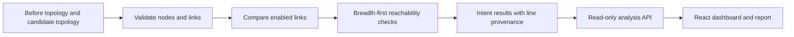

# ChangeShield

ChangeShield is a read-only network-change reviewer. It compares a declared before/after topology and checks reachability and isolation intents before deployment.

## Scope

This MVP models networks as nodes and enabled links. It finds paths with breadth-first search, reports changed links and the candidate config-line provenance, and marks unsupported lines as uncertainty. It does not parse vendor device configuration, connect to devices, deploy changes, or generate automatic fixes. Use the explicit topology model and do not interpret PASS as full device-configuration verification.

## How it works

ChangeShield compares two explicit topology snapshots and checks requested connectivity and isolation properties before a proposed change is reviewed.

The analyzer reports paths, changed links, and unsupported input as uncertainty. A PASS means the modeled topology satisfies the supplied checks; it does not verify vendor device configuration. No device connection, deployment, or automatic fix is performed.

## Run locally

Requires Python 3.11+ and Node.js 20+.

~~~powershell
cd D:\Projects\Devops_Engineer\ChangeShield
uv sync --extra dev
Copy-Item .env.example .env
uv run python -m changeshield
~~~

API docs: http://127.0.0.1:8010/docs.

~~~powershell
cd D:\Projects\Devops_Engineer\ChangeShield\dashboard
npm install
npm run dev
~~~

Viewer tokens can read prior reports. Analyst tokens can submit analyses. Admin inherits both. Replace local example tokens before use beyond a local demonstration.

## Verify

~~~powershell
uv run pytest
npm --prefix dashboard run build
~~~

